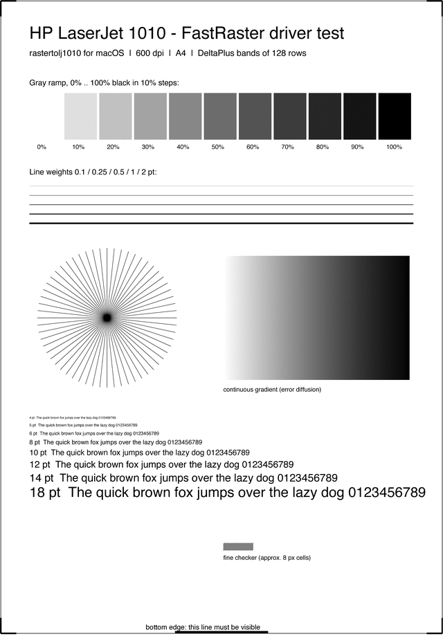

# HP LaserJet 1010 driver for macOS

**A working driver for the HP LaserJet 1010 and 1012 on modern macOS:
Apple Silicon (M1, M2, M3, M4) and Intel, macOS 11 Big Sur and later (Sonoma, Sequoia, Tahoe).**

[](https://github.com/Dreamer0iQ/hp-laserjet-1010-macos-driver/actions/workflows/build.yml)


HP never released a LaserJet 1010 driver for current macOS. The usual advice, macOS's
built-in *Generic PCL* / *HP LaserJet Series PCL 4/5* driver, only half works: the 1010
doesn't really speak PCL. Jobs come out at random, and sooner or later the printer
locks up with **"Unsupported Personality: PCL"** until you switch it off and on again.

This driver speaks the printer's native language, **HP FastRaster**. It sends the same
data HP's own Linux driver (HPLIP) does, so printing is reliable: text, graphics, photos,
any page size.

- Native CUPS driver: shows up in every Print dialog like any other printer
- Universal binary for Apple Silicon and Intel, no Rosetta, no Ghostscript, no Homebrew
- macOS matches it to the printer by USB device ID, so you don't have to pick a driver by hand
- Toner density, EconoMode and halftoning options in the Print dialog

<br clear="right">

## Install

### Option 1: installer package (easiest)

1. Plug the printer into your Mac over USB and switch it on.
2. Download **`HP-LaserJet-1010-macOS-<version>.pkg`** from
   [**Releases**](https://github.com/Dreamer0iQ/hp-laserjet-1010-macos-driver/releases/latest).
3. Open the `.pkg`. The package isn't notarized by Apple, so macOS will refuse at first:
   open **System Settings → Privacy & Security**, scroll down and click **Open Anyway**.
4. Follow the installer. It adds a printer called **HP LaserJet 1010**, ready to use.

If the printer wasn't connected while you installed: **System Settings → Printers &
Scanners → Add Printer…**, select **hp LaserJet 1010**, and make sure **Use** says
**HP LaserJet 1010 FastRaster** (macOS normally picks it by itself).

### Option 2: build from source

```sh
xcode-select --install        # only if you don't have the command line tools yet
git clone https://github.com/Dreamer0iQ/hp-laserjet-1010-macos-driver.git
cd hp-laserjet-1010-macos-driver
make
sudo ./install.sh
```

### Uninstall

```sh
sudo /Library/Printers/HP1010FastRaster/uninstall.sh
```

This removes the driver and every printer queue that uses it.

## Print settings

Under **Printer Features** in the Print dialog:

| Option | Values | Default |
|---|---|---|
| Toner Density | 1 (lightest) … 5 (darkest) | 3, the printer's factory setting |
| EconoMode | Off / On (uses less toner, lighter print) | Off |
| Halftoning | Error diffusion (photos, gray) / Threshold (crisp text and line art) | Error diffusion |

Paper sizes: A4, Letter, Legal, Executive, A5, A6, B5, envelopes (#10, DL, C5, Monarch),
postcards and custom sizes from 3×5 in up to 8.5×14 in. Resolution is 600 dpi.

## Compatibility

| Printer | Status |
|---|---|
| HP LaserJet 1010 | ✅ Tested |
| HP LaserJet 1012 | Should work: HP drives it with the exact same FastRaster stream. Not tested yet; reports welcome |
| HP LaserJet 1015 | Not covered. It has real PCL 5e, so macOS's built-in *HP LaserJet Series PCL 4/5* driver is the one to use |

Tested on macOS 15.5 Sequoia on an Apple M1 Pro. The filter only uses the standard CUPS
API, which has been stable since macOS 11, so Big Sur through Sonoma and 26 Tahoe should
behave the same. If you try one of them, please open an issue and say how it went.

## Troubleshooting

**The printer doesn't appear.** Run `lpinfo -v | grep -i laserjet` in Terminal. You should
see `usb://Hewlett-Packard/hp%20LaserJet%201010?serial=…`. If nothing shows up, macOS
doesn't see the printer at all: check the power, the cable and the USB port.

**Lights blinking, nothing prints.** Cancel the stuck jobs (click the printer icon in the
Dock), then switch the printer off and on.

**Collecting logs for a bug report.** Run `cupsctl --debug-logging`, print once more, and
attach the relevant part of `/var/log/cups/error_log` to the issue.
`cupsctl --no-debug-logging` turns logging off again.

## How it works

```
app → PDF → cgpdftoraster (macOS) → rastertolj1010 (this driver) → USB → printer
              8-bit gray, 600 dpi        1-bit FastRaster stream
```

The LaserJet 1010 has no real page description language. HP calls it "host-based": the
computer renders every page, and the printer accepts it in a format HP calls FastRaster:

- a PJL header (resolution, density, EconoMode), then `ENTER LANGUAGE=PCLXL`;
- a PCL XL session with one specific `VendorUnique` operator right after `BeginSession`.
  Without it the printer reports "Unsupported Personality";
- for each page, `BeginPage`, then bands of 128 rows. Every band is a `VendorUnique`
  operator carrying a 25-byte header and 1-bit pixels compressed with HP's **DeltaPlus**
  scheme (seed-row copies, location prediction, runs and literals).

`rastertolj1010` takes 8-bit gray pages from macOS, dithers them to 1 bit with
Floyd–Steinberg error diffusion, cuts them into bands, compresses each band and wraps it
all as above.

The stream layout and the DeltaPlus encoder come from HPLIP's `hpcups` (HP's open-source
Linux driver), with one bug fixed. `hpcups` never sends the last partial band of a page;
it carries those rows over to the top of the *next* page. On Letter paper (6400 rows = 50
bands) nobody notices. On A4 the bottom 30 rows of the last page get lost, and every
following page slides down. This driver pads the last band with white and finishes it on
its own page.



**How it's tested:**

- `test/run_dp_test.sh <hplip-source>` compiles HP's original `ModeDeltaPlus.cpp` next to
  `src/deltaplus.c` and compares their output byte for byte on synthetic and real bands
  (774 of 774 identical).
- `make test` renders a test page through the real macOS pipeline
  (`cupsfilter` → `cgpdftoraster` → this filter). It then checks the result with
  `tools/frdecode.py`, an independent FastRaster/DeltaPlus decoder that validates every
  byte of the stream and turns it back into a PNG (on the right).
- A real LaserJet 1010 prints that page correctly.

To send a stream to the printer without installing anything:

```sh
make test
DEVICE_URI='usb://Hewlett-Packard/hp%20LaserJet%201010?serial=XXXX' \
  /usr/libexec/cups/backend/usb 1 "$USER" test 1 '' build/test/testpage.fr
```

<br clear="right">

| Path | Contents |
|---|---|
| `src/rastertolj1010.c` | CUPS filter: options, dithering, bands, PJL/PCL XL framing |
| `src/deltaplus.c` | DeltaPlus encoder (port of HPLIP `ModeDeltaPlus.cpp`) |
| `ppd/hp1010fr.drv` | PPD source for `ppdc` |
| `scripts/postinstall` | registers the PPDs and adds a queue for each connected printer |
| `tools/frdecode.py` | FastRaster stream validator/decoder → PNG |
| `tools/testpage.py`, `tools/mkpkg.sh` | test page generator, installer package builder |

## Credits

- FastRaster stream layout and the DeltaPlus encoder:
  [HPLIP](https://developers.hp.com/hp-linux-imaging-and-printing), © HP, BSD-3-Clause.
- The [foomatic-db](https://github.com/OpenPrinting/foomatic-db) notes on the 1010, where
  Carl Michal traced "Unsupported Personality" to the missing `VendorUnique` sequence.
- Printer photo: [LaserJet1012.jpg](https://commons.wikimedia.org/wiki/File:LaserJet1012.jpg)
  by Stehfun, [CC BY 2.5](https://creativecommons.org/licenses/by/2.5), via Wikimedia
  Commons. The 1012 shares the 1010's body.

Licensed under the [BSD 3-Clause License](LICENSE).

---

## На русском

**Драйвер HP LaserJet 1010 / 1012 для macOS** на Mac с M1/M2/M3/M4 и Intel, macOS 11–15
(Sonoma, Sequoia). Официального драйвера от HP под современную macOS нет. Встроенный в
macOS PCL-драйвер печатает через раз и вешает принтер ошибкой «Unsupported Personality:
PCL». Этот драйвер говорит с принтером на его родном протоколе HP FastRaster и печатает
стабильно.

**Установка.** Подключите принтер по USB и включите его. Скачайте `.pkg` из
[Releases](https://github.com/Dreamer0iQ/hp-laserjet-1010-macos-driver/releases/latest)
и откройте. Пакет не нотаризован в Apple, поэтому macOS сначала откажется его открывать:
зайдите в **Системные настройки → Конфиденциальность и безопасность** и нажмите
**«Всё равно открыть»**. После установки появится принтер **HP LaserJet 1010**.

Из исходников: `make && sudo ./install.sh`.
Удаление: `sudo /Library/Printers/HP1010FastRaster/uninstall.sh`.
