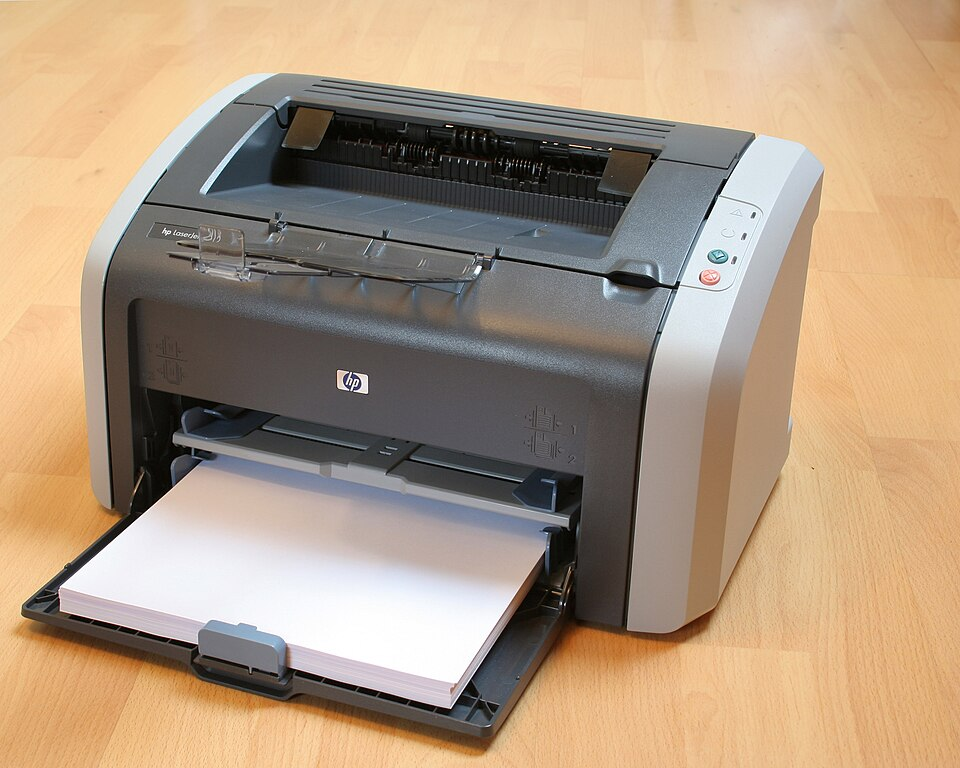

# HP LaserJet 1010 driver for macOS

Driver for the **HP LaserJet 1010 / 1012** on modern macOS: Apple Silicon (M1–M4) and Intel,
macOS 11 and later (Sonoma, Sequoia, Tahoe).

HP never released a driver for these printers for current macOS. The built-in generic PCL
driver prints only now and then and locks the printer with **"Unsupported Personality:
PCL"**. This driver speaks the printer's native HP FastRaster protocol, the same one HP's
Linux driver uses, so printing just works.

 

## Install

1. Connect the printer over USB and turn it on.
2. Download the `.pkg` from [**Releases**](https://github.com/Dreamer0iQ/hp-laserjet-1010-macos-driver/releases/latest) and open it.
   The package isn't notarized: if macOS blocks it, go to **System Settings → Privacy & Security → Open Anyway**.
3. The installer adds the printer **HP LaserJet 1010**. Print from any app with ⌘P.

From source: `make && sudo ./install.sh`
Uninstall: `sudo /Library/Printers/HP1010FastRaster/uninstall.sh`

## Compatibility

- **LaserJet 1010**: tested on macOS 15.5, Apple M1 Pro.
- **LaserJet 1012**: same protocol, should work (untested, reports welcome).
- **LaserJet 1015**: not needed, it supports PCL 5e. Use macOS's built-in *HP LaserJet Series PCL 4/5*.

## Troubleshooting

**The green light blinks forever and no paper is fed.** This usually follows an earlier
error. Press **Cancel Job**, then cold-reset the printer: switch it off, hold **Go** while
switching it on, and release after 10–20 s, once the lights start cycling. Don't hold it
longer than 30 s: that clears NVRAM, including the serial number.

## How it works

`rastertolj1010` is a CUPS filter. It takes the 600 dpi gray page from macOS, screens it to
1 bit, splits it into 128-row bands compressed with HP's DeltaPlus scheme, and wraps them in
PJL + PCL XL `VendorUnique` operators. The protocol and compressor come from
[HPLIP](https://developers.hp.com/hp-linux-imaging-and-printing). The compressor is verified
byte for byte against HP's original. Unlike HPLIP, the driver sends real-width rows and uses
a clustered-dot screen, so dense pages don't overrun the printer. `make test` renders a test
page through CUPS and decodes the result back to PNG.

## Credits

[HPLIP](https://developers.hp.com/hp-linux-imaging-and-printing) (© HP, BSD-3-Clause) ·
[foomatic-db](https://github.com/OpenPrinting/foomatic-db) notes on the 1010 ·
photo [LaserJet1012.jpg](https://commons.wikimedia.org/wiki/File:LaserJet1012.jpg) by Stehfun, CC BY 2.5.
License: [BSD 3-Clause](LICENSE).

---

**На русском.** Драйвер HP LaserJet 1010 / 1012 для macOS (M1–M4 и Intel). Скачайте `.pkg`
из [Releases](https://github.com/Dreamer0iQ/hp-laserjet-1010-macos-driver/releases/latest)
и откройте его. Если macOS ругается, зайдите в «Системные настройки → Конфиденциальность и
безопасность» и нажмите «Всё равно открыть». Принтер появится сам, печать через ⌘P.
Если принтер бесконечно мигает зелёным и не берёт лист, нажмите Cancel Job, потом
выключите его, зажмите Go и включите. Отпустите через 10–20 секунд, когда лампочки побегут
по кругу (дольше 30 секунд не держите).
